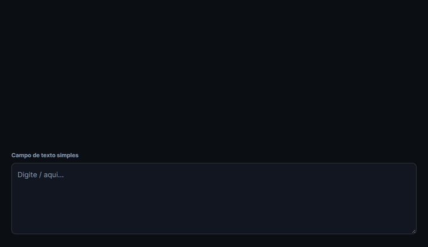
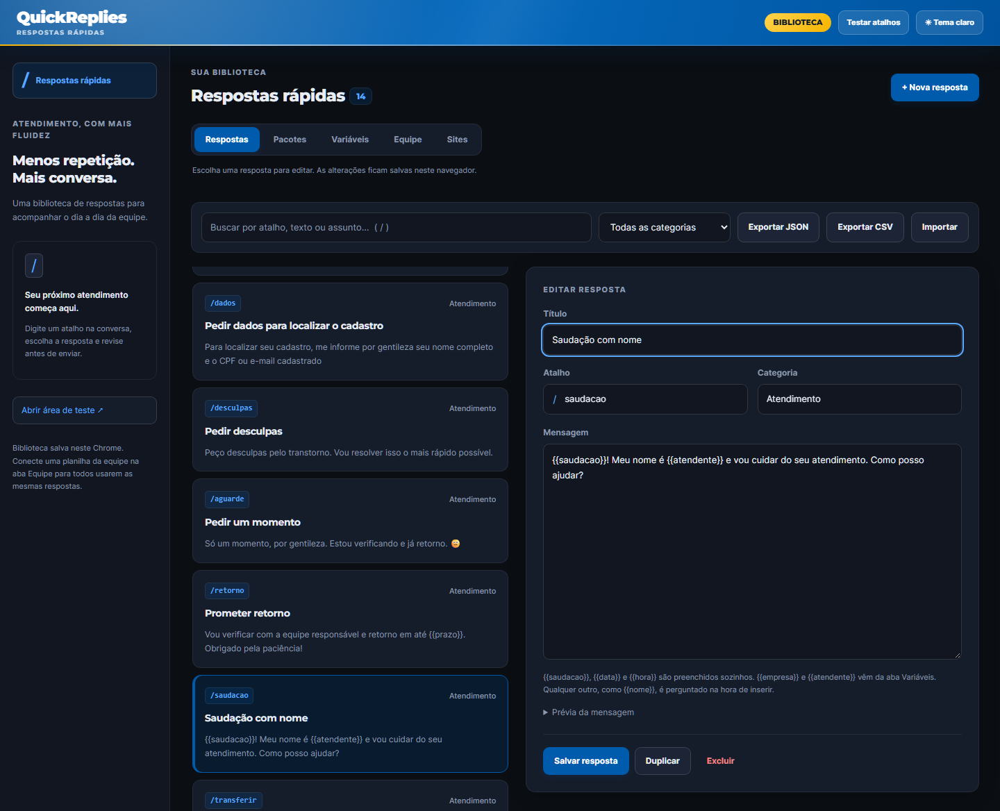
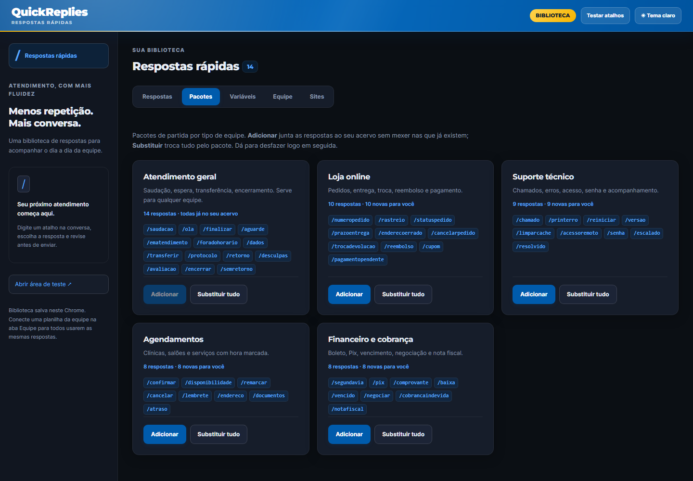

# Quick Replies

[](https://github.com/JvFaraco/blip-quick-replies-demo/actions/workflows/testes.yml)

Extensão Chrome (Manifest V3) de respostas rápidas para quem atende em chat web: [Blip](https://www.blip.ai/), Zendesk, Intercom, WhatsApp Web, HubSpot ou o sistema da sua empresa.
Na conversa, digite `/`, escolha uma mensagem com ↑ ↓ e insira com Tab ou Enter.
A extensão só preenche o campo. Quem revisa e envia é o atendente.

**[Experimente no navegador, sem instalar →](https://jvfaraco.github.io/blip-quick-replies-demo/)**



Nasceu de uma versão interna usada pela equipe de atendimento do Alarme 365, da Orsegups. Esta é a versão pública, com bibliotecas fictícias para você trocar pelas respostas da sua equipe.

## O que ela faz

- **Atalhos com `/`** no campo de mensagem: busca por atalho, título, categoria ou texto, sem diferenciar acentos.
- **Funciona em qualquer site.** Abra a conversa, clique no ícone da extensão e em **Ativar nesta aba**. O site fica salvo e, da próxima vez, o `/` já funciona sozinho. No Blip não precisa ativar.
- **Biblioteca da equipe por planilha.** O gestor mantém uma planilha do Google; cada atendente cola o link uma vez e a extensão atualiza sozinha a cada 30 minutos. Respostas próprias do atendente continuam dele.
- **Variáveis automáticas**: `{{saudacao}}` vira "Bom dia", "Boa tarde" ou "Boa noite" conforme a hora; `{{data}}` e `{{hora}}` também.
- **Variáveis fixas**: `{{empresa}}`, `{{atendente}}` ou qualquer outra que você cadastrar uma vez na aba Variáveis e nunca mais digitar.
- **Campos na hora**: qualquer outra variável, como `{{nome}}` ou `{{pedido}}`, abre um formulário curto antes de inserir. Campo repetido pede um valor só.
- **Pacotes de partida** por tipo de equipe: atendimento geral, loja online, suporte técnico, agendamentos, financeiro. Adicione ao seu acervo ou substitua tudo, com desfazer.
- **Biblioteca editável**: criar, editar, duplicar, excluir, exportar e importar em **JSON ou CSV** (planilha do Excel ou Google Planilhas).
- **Funciona em `textarea` e em editor rico** (`contenteditable`), preservando o texto em volta e o Ctrl+Z.
- **Popup** para buscar e copiar uma resposta já preenchida.
- Tema claro e escuro, navegação por teclado, layout que cabe no celular.



## Instalar

**Pacote pronto:** baixe o `.zip` da [última release](../../releases/latest), descompacte, abra `chrome://extensions`, ative o **Modo do desenvolvedor** e clique em **Carregar sem compactação** apontando para a pasta `quick-replies`.

**Pelo código:**

1. Clone o repositório.
2. Abra `chrome://extensions`, ative o **Modo do desenvolvedor**.
3. Clique em **Carregar sem compactação** e escolha a pasta do projeto.

Funciona também no Edge (`edge://extensions`). Ao instalar, a biblioteca abre com os três primeiros passos.

## Como usar em 1 minuto

1. Abra a conversa no seu sistema de atendimento.
2. Clique no ícone da extensão e em **Ativar nesta aba**. Permita o acesso ao site quando o navegador perguntar.
3. Clique no campo de mensagem e digite `/`.
4. Em **Gerenciar biblioteca**, escolha um pacote de partida na aba **Pacotes** e preencha `{{empresa}}` e `{{atendente}}` na aba **Variáveis**.

Para testar sem nenhum sistema, abra a área de teste pelo link **Testar atalhos** na biblioteca.

## Biblioteca da equipe (planilha do Google)

1. Crie uma planilha com as colunas `atalho`, `titulo`, `categoria` e `mensagem`. Na aba **Equipe** há um botão que copia um modelo pronto.
2. Compartilhar → Acesso geral → **Qualquer pessoa com o link**, como Leitor.
3. Cada atendente cola o link da planilha na aba **Equipe** e clica em **Conectar**.

A partir daí a extensão baixa a planilha a cada 30 minutos e ao abrir o navegador. Linhas removidas da planilha somem da biblioteca; respostas criadas pelo atendente com atalhos que não estão na planilha ficam. Um link direto para CSV ou para o JSON exportado também funciona.



## Privacidade

Não tem servidor próprio. Biblioteca, variáveis, lista de sites e link da planilha ficam em `chrome.storage.local`, no navegador de quem usa.
A extensão não registra conversas nem os valores digitados nos campos variáveis.
O conteúdo só roda nos sites que você ativou (e em `*.blip.ai` por padrão); a permissão de cada site é pedida ao navegador na hora de ativar e pode ser removida na aba **Sites**.
O único acesso à rede é baixar a planilha da equipe que você conectou. Mensagens e campos são inseridos como texto, sem interpretar HTML.

## Estrutura

| Arquivo | Papel |
| --- | --- |
| `catalogo.js` | Pacotes de partida (fictícios) e biblioteca padrão |
| `core.js` | Validação, busca, detecção do atalho, variáveis, CSV, sites, planilha da equipe, armazenamento |
| `content.js` | Menu dentro da página (shadow DOM fechado) e inserção no campo |
| `background.js` | Service worker: registra o menu nos sites salvos, sincroniza a planilha, abre a biblioteca na instalação |
| `popup.*` | Busca rápida com cópia e **Ativar nesta aba** |
| `biblioteca.*` | Editor da biblioteca: respostas, pacotes, variáveis, equipe e sites |
| `empacotar.py` | Gera o `.zip` em `dist/` com uma lista explícita de arquivos (`--loja` gera o formato da Chrome Web Store) |
| `scripts/gravar-gif.cjs` + `scripts/montar-gif.py` | Gravam o GIF do README com Playwright e Pillow |
| `docs/` | Página de demonstração do GitHub Pages; `npm run demo` copia para `docs/extensao/` os arquivos da extensão que ela usa |
| `loja/` + `scripts/gerar-loja.cjs` | Pacote da Chrome Web Store: textos, respostas da aba de privacidade e imagens (`npm run loja`) |

## Testes

```bash
npm install
npm test                       # unitários e do pacote (node:test) + navegador (Playwright)
PW_CHANNEL=msedge npm test     # sem Chrome instalado, usa o Edge
PW_CHANNEL=chromium npm test   # Chromium do Playwright (é o que a CI usa)
```

Os testes do pacote conferem que o `.zip` leva todos os arquivos que a extensão carrega, que `manifest.json` e `package.json` têm a mesma versão e que a cópia da extensão em `docs/extensao/` está em dia.

## Publicar uma versão

1. Aumente `version` em `manifest.json` e `package.json`.
2. Se mexeu em `core.js`, `content.js` ou `catalogo.js`, rode `npm run demo`; se a interface mudou, `npm run loja`.
3. Crie e envie a tag: `git tag v1.2.1 && git push origin v1.2.1`.

O workflow [Release](.github/workflows/release.yml) confere a tag, roda os testes e anexa à release os dois zips: `quick-replies-<versão>.zip` (carregar sem compactação) e `quick-replies-loja-<versão>.zip` (enviar à Chrome Web Store). O que preencher no painel da loja está em [`loja/README.md`](loja/README.md).

**Página de demonstração:** em Settings → Pages, escolha *Deploy from a branch*, branch `main`, pasta `/docs`.

## Licença

MIT. Fontes Inter e Montserrat sob SIL Open Font License (`vendor/`).
